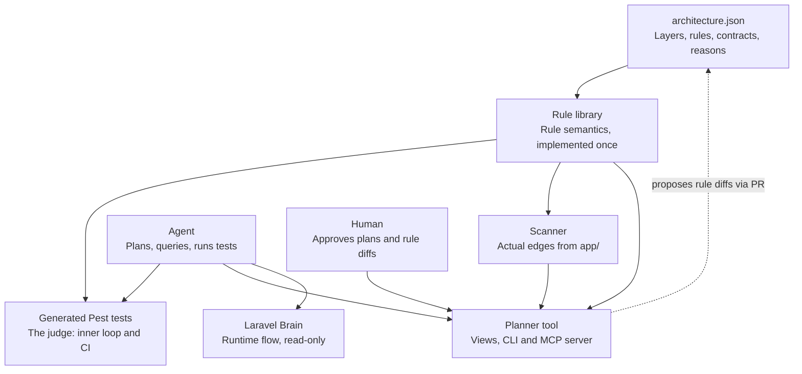
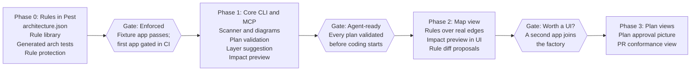

> **Non-binding input.** This is the work-in-progress draft that started the wayfinder effort for laravel-visual-spec. Every claim in it, including terms, principles, schema, roadmap and non-goals, is an open question until a ticket on the map decides it. Cite it as a source of candidate ideas; never treat it as settled.
>
> Terminology has since moved on: what this draft calls the "rule map" or `architecture.json` is provisionally the **architecture spec** (see `GLOSSARY.md`).

# Architecture planner & validator — WIP spec

As of 2026-10-16

## Summary

We will build a planning-first architecture tool for the Laravel software factory. One JSON rule map is the spec that agents and humans plan against. Generated Pest tests enforce it. A purpose-built tool lets us author, reason about and review those rules against the app as it actually is.

**Problem.** Agents write code faster than humans can review its structure, so architecture drifts unless boundaries are hard and checked automatically. Existing tools each cover one part: Deptrac enforces layers with its own config, Laravel Brain describes how the app flows, and Pest enforces rules in the test suite. None of them lets us edit rules visually against the real app, or validate a plan before code exists.

**Goals**

- Hard, deterministic boundaries for layers, feature modules and contracts, checked in the agent's inner loop and in CI.
- Every plan validated against the architecture before implementation starts.
- Human review reduced to a picture: rule changes, plan approvals and PR conformance.
- One source of truth that the agent, the human and the tests all read.
- An efficient agent loop: failure messages that say how to fix the problem, and complete violation lists wherever possible.

## Principles and non-goals

Pest is the judge; the tool is advisory. A wrong picture can mislead, but it can never let a violation merge.

**Principles**

1. **Rules are data, not code.** `architecture.json` is the single source of truth. Generators, tests and the tool read it; none of them hold rules of their own.
2. **One interpretation of the rules.** A small PHP rule library implements the semantics once. The Pest generators, the scanner and the tool all call it.
3. **The tool proposes; it never commits.** Rule edits made in the UI produce a diff to `architecture.json` that goes through PR and CODEOWNERS review.
4. **Human and agent share one model.** Every operation the UI offers is also available through a CLI with JSON output and an MCP server.
5. **Architecture is class-level.** When finer control is needed, split the interface (for example `ChargesPayments` and `RefundsPayments`). Never police individual method calls.
6. **Be honest about blind spots.** Dependencies that static analysis can't see, such as `app()` calls or container lookups by string, are labelled as unknown rather than drawn as no edge.
7. **Deterministic output.** The same code and the same map always produce the same result, diagram and agent context.

**Non-goals**

- Describing runtime behaviour: request flow, queries, cache use. Laravel Brain already does this and can be consulted through its MCP server.
- Method-level or business-logic rules.
- Type correctness. PHPStan and Larastan stay in the pipeline for that.
- Supporting codebases that aren't laid out by namespace. The factory enforces "namespace = layer".

## System overview

Everything reads one map through one rule library: Pest judges, the scanner observes, and the planner proposes.



Because the tests, the scanner and the planner share the rule library, the picture and the tests can't disagree. The planner never edits the map directly; it proposes a diff that a human approves in a PR.

## Rule model

All rules live in `architecture.json` at the repo root. Every rule carries a `reason`, which is shown in the UI and used as the Pest failure message. The draft schema:

```json
{
  "version": 1,
  "layers": {
    "Http":     { "namespace": "App\\Http" },
    "Features": { "namespace": "App\\Features" },
    "Domain":   { "namespace": "App\\Domain" },
    "Models":   { "namespace": "App\\Models" },
    "Infra":    { "namespace": "App\\Infrastructure" },
    "Platform": { "namespace": "App\\Providers" }
  },
  "allow": {
    "Http":     { "to": ["Features", "Domain"], "reason": "Controllers delegate to features; no persistence in HTTP." },
    "Features": { "to": ["Domain", "Models", "Infra"], "reason": "Features orchestrate domain, persistence and infrastructure." },
    "Domain":   { "to": [], "reason": "Domain stays framework-free and dependency-free." },
    "Models":   { "to": ["Domain"], "reason": "Models may use domain value objects only." },
    "Infra":    { "to": ["Domain", "Models"], "reason": "Adapters implement domain contracts." },
    "Platform": { "to": ["Http", "Features", "Domain", "Models", "Infra"], "reason": "Providers wire everything." }
  },
  "features": { "namespace": "App\\Features", "private": "Internal", "public": "Contracts" },
  "contracts": {
    "App\\Domain\\Contracts\\RefundsPayments": {
      "used_in": ["App\\Features\\Billing\\Actions\\RefundAction"],
      "implemented_in": ["App\\Infrastructure\\Payments"],
      "reason": "Only the refund flow may issue refunds."
    }
  },
  "bans": [
    { "in": "App\\Features", "not_use": ["app", "resolve"], "reason": "Dependencies arrive through constructors so the rules can see them." }
  ],
  "ignoring": {
    "Http->Models": ["App\\Http\\Controllers\\LegacyReportController"]
  }
}
```

**Semantics.** Each rule kind maps to one generated check.

| Rule kind | Meaning | Generated as |
| --- | --- | --- |
| Layer allowlist | A layer may depend only on the listed layers. Dependencies on unmapped code (vendor, framework) are ignored, as in Deptrac. | One `not->toUse()` test per forbidden layer pair |
| Feature privacy | `Features\X\Internal` may only be used inside feature X; others go through `Features\X\Contracts`. | `toOnlyBeUsedIn()` per feature folder |
| Contract usage | Only `used_in` (plus implementers and `App\Providers`) may reference the interface. | `toOnlyBeUsedIn()` |
| Contract implementation | Only classes in `implemented_in` may implement the interface. | `not->toImplement()` with `ignoring(implemented_in)` |
| Implementation hiding | Concrete implementations are referenced only by their own namespace and container bindings. | `toOnlyBeUsedIn(implemented_in + App\Providers)` |
| Bans | Functions or classes that may not be used in a namespace. | `not->toUse()` |
| Unassigned classes | Every class under `app/` must belong to a layer. | Collect-all test over the files under `app/` |
| Baseline (`ignoring`) | Known violations tolerated for now. | `->ignoring()` on the matching rule; the list may only shrink |

The JSON is protected by CODEOWNERS and an agent hook. Agents propose changes to it but cannot merge them.

## Enforcement layer

Pest enforces every rule through tests generated from `architecture.json`. The generators use only Pest's documented API.

**Generated tests**

- `tests/Arch/LayersTest.php` loops over the layer map and emits one `not->toUse()` test per forbidden layer pair, plus a feature-privacy test per folder under `app/Features`.
- `tests/Arch/ContractsTest.php` emits the usage, implementation and hiding rules for each contract.
- `tests/Arch/MapTest.php` holds the collect-all checks: every class belongs to a layer, and `toBeCasedCorrectly()` keeps the path-to-class mapping valid.
- Failure messages follow one template: `{Layer} must not depend on {Target}; it may only use {allowed}. Why: {reason}`.

**Pest behaviours we design around**

| Behaviour | Mitigation |
| --- | --- |
| Arch tests stop at the first violation | One test per rule pair limits the damage; bulk-prone checks are written as collect-all tests that fail once with the full list |
| `@pest-arch-ignore-line` is always honoured | CI fails if `grep -rn "@pest-arch-ignore" app/` finds anything |
| A selector that matches nothing passes | The unassigned-class test fails when a typo'd namespace leaves classes unmapped |
| Custom arch expectations rely on internal Pest classes | Avoided in v1; if added later, pin Pest's major version |

**Rule protection**

- CODEOWNERS on `architecture.json`, `tests/Arch/` and the rule library.
- An agent pre-edit hook rejects writes to those paths.
- A CI check fails if any `ignoring` list grows.

**Loops**

- Inner loop: the agent runs `vendor/bin/pest tests/Arch` after edits and before declaring work done.
- Outer loop: CI runs the same tests plus the protection checks.
- The generators have their own fixture app with known violations, including two violations of one rule, so we can confirm reporting behaviour on each Pest upgrade.

## Planning workflow

Every plan carries an architecture section, and the plan is validated twice before implementation: first statically, then on a code skeleton.

**Plan format (draft)**

```yaml
architecture:
  - class: App\Features\Billing\Actions\RefundAction
    layer: Features            # optional; the tool can suggest one
    depends_on:
      - App\Domain\Contracts\RefundsPayments
      - App\Models\Invoice
  - class: App\Http\Controllers\Billing\RefundController
    layer: Http
    depends_on: [App\Features\Billing\Actions\RefundAction]
```

**Steps**

1. **Draft.** The agent writes the plan and asks the tool which layer each new class belongs in (`suggest-layer`).
2. **Static validation.** The tool checks the plan against the map without any code: every class lands in a layer, every planned dependency is allowed, every contract rule holds. Output is a deterministic JSON report.
3. **Skeleton gate.** The agent creates empty classes whose constructors type-hint the planned dependencies, then runs `pest tests/Arch`. This catches namespace typos and conflicts with existing code that static validation can't see.
4. **Human approval.** The human approves the plan as a picture in the plan view, not as YAML.
5. **Implementation.** The agent builds the feature with the inner loop running.
6. **Conformance review.** The tool compares planned edges with actual edges for the feature's classes. Edges built but not planned are amber; edges planned but not built are dashed grey. The human reviews only red and amber.

**Layer suggestion.** The legal layers for a class are those whose allowlist covers the layer of every dependency, after feature-privacy and contract rules are applied. An empty result means the plan needs a new contract or a rule change, and the tool says which.

**Impact preview for rule changes.** Given a proposed edit to `architecture.json`, the tool reports:

- existing edges that would become forbidden, or newly allowed;
- classes that would become unassigned;
- in-flight plans that would fail validation.

The preview is attached to the PR that changes the rules.

## Planner tool

The tool is a Laravel dev package with three views, a CLI and an MCP server. All of them sit on the same rule library and scanner.

**Views**

| View | Shows | Used for |
| --- | --- | --- |
| Map | Layers as boxes in fixed positions, allowed rules, actual edges (grey allowed, red forbidden), unassigned classes. Click a layer for its classes; click an edge for its file and line references. | Editing rules, with an impact preview before any change is proposed |
| Plan | A plan's classes placed in their layers, planned edges validated live | Approving a plan before code exists |
| Conformance | Planned edges against built edges for one feature or PR; only the change is shown | PR review: red and amber edges only |

**Operations** (the CLI command and MCP tool share each name)

| Operation | Input | Output |
| --- | --- | --- |
| `scan` | Codebase | Actual class-level edges with file:line references, plus dependencies the scanner can't resolve |
| `layer-of` | Class name | Layer, or "unassigned" |
| `check-dependency` | From class, to class | Allowed or forbidden, with the rule's reason |
| `suggest-layer` | Planned dependencies | Legal layers, or why there are none |
| `validate-plan` | Plan file | Deterministic report of violations |
| `impact` | Proposed `architecture.json` | Edges, classes and plans that would change status |
| `conformance` | Plan file, git ref | Planned against built edges |
| `diagram` | View, format | Mermaid for PR comments, or an interactive HTML file |

**Packaging**

- Installed as a `require-dev` Laravel package. Routes and commands register only in the `local` environment, plus an explicit CI mode for `scan`, `validate-plan`, `conformance` and `diagram`.
- The scan writes JSON to `storage/`; the viewer is a single-page app served from a route such as `/_arch`.
- The scanner uses `nikic/php-parser` with its `NameResolver`, which Pest's arch plugin already pulls in. Rescans touch only changed files.
- The MCP server uses `laravel/mcp`.
- Rendering: Mermaid for PR comments (GitHub renders it inline), and Cytoscape.js for the interactive views.

**Rendering rules**

- Show layers by default; classes appear only on drill-down.
- Use colour only for meaning: grey allowed, red forbidden, amber unplanned, dashed grey planned but not built, dashed box for unassigned.
- Keep each layer in the same position in every diagram, so diagrams compare across PRs at a glance.
- PR views show only what the PR changed.

## Lessons from Laravel Brain

We take ideas from [laramint/laravel-brain](https://github.com/laramint/laravel-brain) and keep using it alongside our tool for runtime flow. Brain is MIT-licensed, so its ideas are free to borrow, and its code can be reused if we keep the licence notice.

| What Brain does | How we apply it |
| --- | --- |
| Flags dispatches it can't resolve statically instead of showing no impact | Draw `app()` calls and container lookups by string as "unknown" edges, never as no edge |
| Colours unreached classes grey as a question, not a verdict | Show unassigned classes in a dashed box as an open question |
| Reports isolated nodes and nodes outside any tab as separate counts | Report unassigned classes and rules that match nothing as separate counts |
| Exports deterministic, token-budgeted context for agents | Make `validate-plan` and all agent-facing output deterministic, with a token budget |
| Writes the scan as JSON to `storage/` and serves the viewer through app routes, local only | Same packaging |
| Watch mode re-traces only changed files and merges the result | Incremental rescans |
| Wires edges on interfaces through to the concrete class bound in the container | Show the implementation behind each contract in the map view |
| Ships an MCP server through `laravel/mcp` | Same, sharing operation names with the CLI |

**Where we differ.** Brain's `brain:generate-rules` writes descriptive files such as `CLAUDE.md` and `AGENTS.md`. Our agent guidance is prescriptive and protected, so Brain must not write to those paths. Brain stays the tool for runtime questions: request flow, sequence diagrams per route, finding callers.

## Limitations and risks

The biggest risk is scope: drifting into a second Brain instead of a planning tool.

| Risk | Effect | Mitigation |
| --- | --- | --- |
| Scope creep into describing runtime behaviour | Maintenance load on a tool that isn't the product | Hold the non-goals; the tool takes four inputs only: the map, static edges, plans, container bindings |
| Only one app goes through the factory | The tool costs more than it saves | Phases 0 and 1 are useful on their own; reassess before building the UI |
| Tool and Pest disagree about a dependency | The picture misleads reviewers | Shared rule library; fixture tests compare scanner edges with Pest results |
| Pest's arch behaviour changes on upgrade | Rules silently weaken or reporting changes | Run the fixture app on every Pest upgrade; pin the major version |
| Pest reports the first violation per test | Extra agent iterations on widespread mistakes | Per-pair tests, collect-all tests, and `scan` listing every violation at once for the agent |
| Static analysis can't see container lookups by string, string-named classes in config, or auto-discovered listeners | Real dependencies go missing from the picture | Label unknown edges; ban `app()` and `resolve()` in features |
| Codebase not laid out by namespace | Layer matching breaks | The factory's scaffolding enforces the layout; `toBeCasedCorrectly()` checks it |
| The UI makes loosening rules too easy | Architecture erodes one convenient edit at a time | The tool only proposes diffs; CODEOWNERS review; impact preview attached to the PR |

## Roadmap

Build the CLI and the rules before any UI; each phase delivers value even if we stop there.



Phases 0 and 1 make the factory enforce and validate plans with no UI at all. Gate 3 is the go/no-go point for the visual tool: build the map view only once a second app goes through the factory.

## Open questions

- [ ] Map format: JSON as proposed, or a PHP file returning an array? JSON is easier for the UI to write and for agents to parse.
- [ ] Where do plans live: a file per plan in the repo, or a section inside the plan document the agent already writes?
- [ ] Do features get their own nested layers (`Features\X\Actions`, `Features\X\Internal`), or only the privacy rule?
- [ ] Container bindings: boot the app and read them at runtime, or parse service providers statically as Brain does?
- [ ] How does CI mode run: `APP_ENV=testing`, or a dedicated flag?
- [ ] Packaging: one package, or separate packages for the rule library, the Pest generators and the tool?
- [ ] Should the rule library also emit `deptrac.yaml`, for a complete violation report as a CI backstop?
- [ ] Brain integration: pull its flow context into the plan view, or keep the two tools separate?
- [ ] Multiple apps: shared base rules as a Composer package that each app's map extends?
- [ ] A name for the tool.
